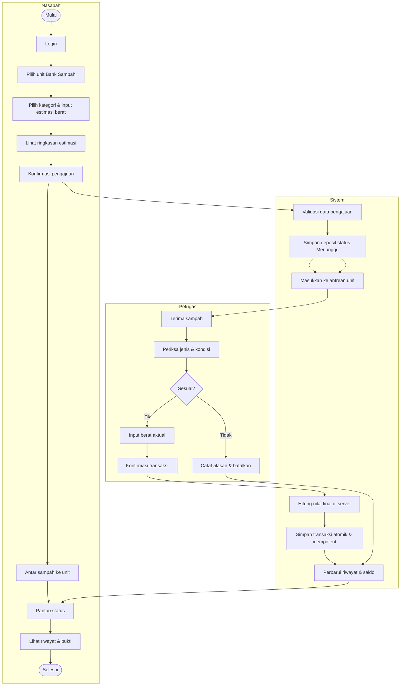
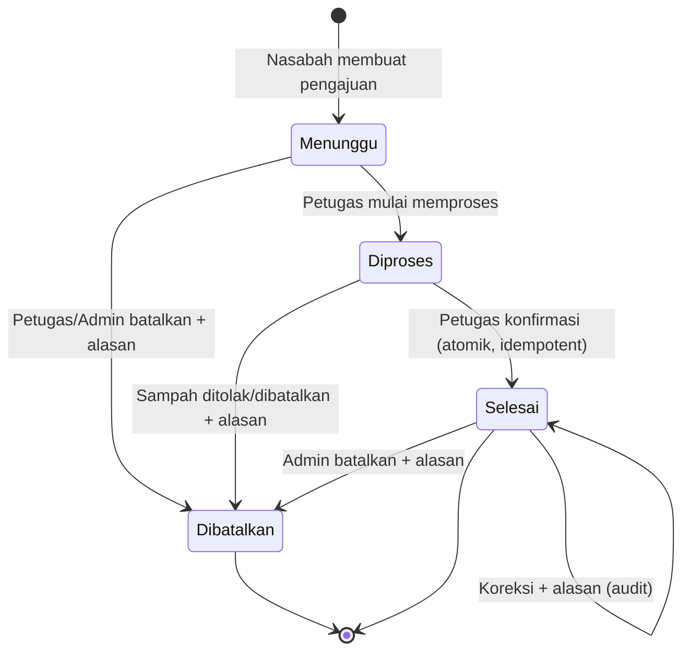
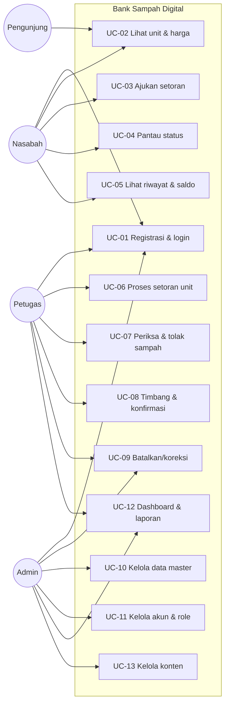

# BPMN, Use Case, dan Matriks Hak Akses

## Bank Sampah Digital

**Dokumen kerja untuk BSD-13 — BPMN alur setoran, use case, dan matriks role**

> Acuan: `docs/PRD_Bank_Sampah_Digital_v1.1.md` (disetujui 12 Nov 2026), `docs/USER_STORIES_P0.md`, dan `docs/BACKLOG..md`. Ruang lingkup MVP adalah **nasabah antar mandiri**; penjemputan tidak termasuk (D-01).

## Informasi Dokumen

| Item | Keterangan |
| --- | --- |
| Task | BSD-13 · BPMN, use case, dan matriks hak akses |
| Versi | 1.0 |
| Tanggal | 12 November 2026 |
| Status | **Disetujui tim/Product Owner** (12 November 2026) |
| Cakupan | Alur setoran mandiri MVP, use case P0/P1, matriks role & endpoint |
| Acuan keputusan | D-01 (antar mandiri), D-03 (satu PWA berbasis role), D-04 (harga unit menimpa global), D-05 (pembatalan/koreksi + audit) |

## 1. Aktor

| Aktor | Deskripsi |
| --- | --- |
| Pengunjung | Belum login; hanya dapat melihat informasi publik yang dipublikasikan. |
| Nasabah | Pengguna terdaftar yang mengajukan dan mengantar sampah sendiri. |
| Petugas | Staf unit yang memproses setoran untuk unit yang ditugaskan. |
| Admin | Pengelola data master, akun, unit, kategori, harga, konten, dan laporan. |
| Sistem | Proses backend: validasi, perhitungan, snapshot harga, audit, dan idempotensi. |

## 2. BPMN Alur Setoran Mandiri (MVP)

### 2.1 Diagram alur (swimlane)

### 2.2 Langkah proses

| No | Aktor | Langkah | Hasil |
| --- | --- | --- | --- |
| 1 | Nasabah | Login | Sesi aktif. |
| 2 | Nasabah | Pilih unit berdasarkan lokasi, jam, dan layanan | Unit tujuan terpilih. |
| 3 | Nasabah | Pilih kategori dan input estimasi berat | Data estimasi tersedia. |
| 4 | Sistem | Tampilkan ringkasan estimasi | Estimasi ditandai **bukan nilai final**. |
| 5 | Nasabah | Konfirmasi pengajuan | Deposit dibuat status **Menunggu**. |
| 6 | Sistem | Validasi & simpan deposit | `submitted_at`, `customer_id`, `unit_id` tercatat. |
| 7 | Sistem | Masukkan ke antrean unit | Petugas unit melihat pengajuan. |
| 8 | Nasabah | Antar sampah sendiri ke unit | Sampah diterima petugas. |
| 9 | Petugas | Periksa jenis & kondisi sampah | Hasil pemeriksaan dicatat. |
| 10 | Petugas | Jika tidak sesuai: catat alasan & batalkan | Status **Dibatalkan**, alasan di `transaction_events`. |
| 11 | Petugas | Jika sesuai: input berat aktual per kategori | Berat aktual tersimpan. |
| 12 | Sistem | Hitung nilai final: berat aktual × harga snapshot | `line_total` & total dihitung di server. |
| 13 | Petugas | Konfirmasi transaksi | Status **Selesai** (atomik & idempotent). |
| 14 | Sistem | Simpan transaksi, perbarui riwayat & saldo | Bukti transaksi tersedia. |
| 15 | Nasabah | Pantau status & lihat riwayat | Status dan nilai final terlihat. |

### 2.3 Alur alternatif dan pengecualian

| Skenario | Pemicu | Penanganan |
| --- | --- | --- |
| Sampah ditolak | Jenis/kondisi tidak sesuai | Petugas wajib mengisi alasan; status **Dibatalkan**; audit dicatat (US-15). |
| Sebagian kategori ditolak | Hanya sebagian tidak sesuai | Kategori ditolak dicatat dengan alasan; kategori diterima lanjut ditimbang. |
| Retry konfirmasi | Jaringan terputus / pengguna mengulang | Idempotency key mencegah transaksi ganda (US-11). |
| Koreksi setelah Selesai | Kesalahan berat/harga | Wajib alasan; nilai lama tetap tertelusur; audit dicatat (US-16). |
| Pembatalan setelah Selesai | Kesalahan operasional | Wajib alasan; status **Dibatalkan**; audit dicatat (US-16). |
| Harga berubah | Admin memperbarui harga | Transaksi lama tetap memakai snapshot harga. |

## 3. State Transition Status Setoran

| Status awal | Aksi | Status akhir | Aktor | Aturan |
| --- | --- | --- | --- | --- |
| — | Buat pengajuan | Menunggu | Nasabah | Data valid; `customer_id` dari sesi. |
| Menunggu | Mulai proses | Diproses | Petugas unit | `processed_at` & event dicatat. |
| Menunggu | Batalkan | Dibatalkan | Petugas unit / Admin | Alasan wajib. |
| Diproses | Konfirmasi | Selesai | Petugas unit | Berat & harga valid; atomik & idempotent. |
| Diproses | Tolak/batalkan | Dibatalkan | Petugas unit / Admin | Alasan wajib; event dicatat. |
| Selesai | Batalkan | Dibatalkan | Admin | Alasan wajib; riwayat tidak dihapus. |
| Selesai | Koreksi | Selesai | Admin | Alasan wajib; nilai lama tertelusur; event dicatat. |
| Dibatalkan | — | — | — | Terminal; tidak ada transisi keluar. |

> **Kebijakan disetujui (12 Nov 2026):** pembatalan/koreksi **setelah Selesai** hanya untuk **Admin**. Petugas unit hanya dapat membatalkan pengajuan **sebelum** status Selesai. Semua aksi tetap wajib alasan dan tercatat di `transaction_events`.

## 4. Use Case

### 4.1 Diagram use case (ringkas)

### 4.2 Daftar use case

| ID | Use case | Aktor utama | FR | US | Prioritas |
| --- | --- | --- | --- | --- | --- |
| UC-01 | Registrasi, login, logout, reset kata sandi | Nasabah, Petugas, Admin | FR-01, FR-02 | US-01, US-02 | P0 |
| UC-02 | Lihat daftar/detail unit & harga sampah | Pengunjung, Nasabah | FR-04, FR-06 | US-03, US-04 | P0 |
| UC-03 | Ajukan setoran & lihat ringkasan estimasi | Nasabah | FR-07, FR-08 | US-05, US-06 | P0 |
| UC-04 | Pantau status pengajuan | Nasabah, Petugas | FR-10 | US-08 | P0 |
| UC-05 | Lihat riwayat & saldo/nilai akumulatif | Nasabah | FR-14, FR-15 | US-12, US-13 | P0 |
| UC-06 | Lihat & proses antrean pengajuan unit | Petugas | FR-09 | US-07 | P0 |
| UC-07 | Periksa & tolak sampah dengan alasan | Petugas | FR-22 | US-15 | P0 |
| UC-08 | Input berat aktual & konfirmasi transaksi | Petugas | FR-11, FR-12, FR-13 | US-09, US-10, US-11 | P0 |
| UC-09 | Batalkan/koreksi transaksi dengan alasan | Petugas, Admin | FR-23 | US-16 | P0 |
| UC-10 | Kelola unit, kategori, harga, publikasi | Admin | FR-16 | US-14 | P0 |
| UC-11 | Kelola akun & role petugas/admin | Admin | FR-02, FR-16 | US-02, US-14 | P0 |
| UC-12 | Lihat dashboard & laporan | Petugas, Admin | FR-17 | — | P1 |
| UC-13 | Kelola konten website | Admin | FR-18 | — | P1 |
| UC-14 | Cari/filter unit | Pengunjung, Nasabah | FR-05 | — | P1 |
| UC-15 | Lihat profil & ubah data profil | Nasabah, Petugas, Admin | FR-03 | — | P1 |
| UC-16 | Lihat bukti transaksi | Nasabah | FR-21 | — | P1 |

### 4.3 Detail use case P0

#### UC-01 · Registrasi, login, logout, reset kata sandi
- **Aktor:** Nasabah (registrasi), Nasabah/Petugas/Admin (login).
- **Prakondisi:** Pengguna belum login; akun petugas/admin sudah dibuat admin.
- **Alur utama:** buka form → isi data → validasi → buat sesi → arahkan sesuai role.
- **Alur alternatif:** data tidak valid → pesan error; akun nonaktif → akses ditolak; kredensial salah → pesan umum.
- **Pascakondisi:** sesi aktif dengan role yang benar.

#### UC-02 · Lihat unit & harga sampah
- **Aktor:** Pengunjung, Nasabah.
- **Prakondisi:** Unit/kategori/harga berstatus aktif dan terpublikasi.
- **Alur utama:** buka daftar → pilih unit → lihat detail (alamat, jam, status, kontak) → lihat kategori & harga.
- **Aturan:** harga unit menimpa global (D-04); data simulasi diberi label.
- **Pascakondisi:** pengguna memperoleh informasi unit dan harga aktif.

#### UC-03 · Ajukan setoran & ringkasan estimasi
- **Aktor:** Nasabah.
- **Prakondisi:** Nasabah login; unit aktif; kategori & harga tersedia.
- **Alur utama:** pilih unit → pilih kategori → input estimasi berat → lihat ringkasan → konfirmasi.
- **Alur alternatif:** data tidak valid → validasi; unit tidak aktif → pilih unit lain.
- **Pascakondisi:** deposit status **Menunggu** masuk antrean unit.

#### UC-04 · Pantau status
- **Aktor:** Nasabah, Petugas.
- **Alur utama:** buka pengajuan → lihat status terkini → lihat riwayat perubahan.
- **Aturan:** nasabah hanya melihat miliknya; petugas hanya unitnya.
- **Pascakondisi:** status terbaru terlihat.

#### UC-05 · Riwayat & saldo
- **Aktor:** Nasabah.
- **Alur utama:** buka riwayat → pilih transaksi → lihat detail → buka saldo/nilai akumulatif.
- **Aturan:** saldo = catatan nilai setoran, **bukan dana cair**; hanya data sendiri.
- **Pascakondisi:** riwayat dan nilai akumulatif tampil.

#### UC-06 · Antrean pengajuan unit
- **Aktor:** Petugas.
- **Prakondisi:** Petugas terhubung ke unit.
- **Alur utama:** buka antrean → filter status → pilih pengajuan → buka detail.
- **Aturan:** hanya pengajuan unit sendiri.
- **Pascakondisi:** petugas siap memproses.

#### UC-07 · Periksa & tolak sampah
- **Aktor:** Petugas.
- **Alur utama:** terima sampah → periksa jenis/kondisi → catat hasil.
- **Alur alternatif:** tidak sesuai → isi alasan wajib → status **Dibatalkan** → audit.
- **Pascakondisi:** hasil pemeriksaan tersimpan.

#### UC-08 · Timbang & konfirmasi
- **Aktor:** Petugas, Sistem.
- **Prakondisi:** pengajuan Diproses; kategori diterima.
- **Alur utama:** input berat aktual → sistem hitung nilai (berat × snapshot) → petugas konfirmasi → status **Selesai**.
- **Aturan:** perhitungan di server; konfirmasi atomik & idempotent.
- **Pascakondisi:** transaksi tersimpan; riwayat & saldo diperbarui.

#### UC-09 · Batalkan/koreksi
- **Aktor:** Petugas (sebelum Selesai), Admin (termasuk setelah Selesai).
- **Alur utama:** pilih transaksi → pilih aksi → isi alasan wajib → simpan → audit.
- **Aturan:** nilai lama tidak dihapus; event mencatat status lama/baru, aktor, alasan, waktu.
- **Pascakondisi:** status/nilai diperbarui dengan jejak audit.

#### UC-10 · Kelola data master
- **Aktor:** Admin.
- **Alur utama:** kelola unit → kategori → harga (periode berlaku) → status publikasi.
- **Aturan:** periode harga tidak boleh tumpang tindih; perubahan harga tidak mengubah transaksi lama.
- **Pascakondisi:** data master diperbarui dan tercatat.

#### UC-11 · Kelola akun & role
- **Aktor:** Admin.
- **Alur utama:** buat akun petugas/admin → tetapkan role/unit → aktifkan/nonaktifkan.
- **Aturan:** registrasi publik tidak dapat membuat akun petugas/admin.
- **Pascakondisi:** akun dan hak akses sesuai kewenangan.

## 5. Matriks Hak Akses (RBAC)

### 5.1 Legenda

| Simbol | Arti |
| --- | --- |
| ✅ | Diizinkan |
| ❌ | Ditolak |
| 🔒 | Hanya data milik sendiri |
| 🏢 | Hanya data unit yang ditugaskan |
| 👁 | Hanya data yang dipublikasikan |

### 5.2 Matriks use case

| Use case | Pengunjung | Nasabah | Petugas | Admin |
| --- | --- | --- | --- | --- |
| UC-01 Registrasi | ✅ (nasabah saja) | ❌ | ❌ | ❌ |
| UC-01 Login/logout | ✅ | ✅ | ✅ | ✅ |
| UC-02 Lihat unit & harga | 👁 | ✅ | ✅ | ✅ |
| UC-03 Ajukan setoran | ❌ | 🔒 | ❌ | ❌ |
| UC-04 Pantau status | ❌ | 🔒 | 🏢 | ✅ |
| UC-05 Riwayat & saldo | ❌ | 🔒 | ❌ | ✅ |
| UC-06 Antrean pengajuan unit | ❌ | ❌ | 🏢 | ✅ |
| UC-07 Periksa & tolak sampah | ❌ | ❌ | 🏢 | ✅ |
| UC-08 Timbang & konfirmasi | ❌ | ❌ | 🏢 | ✅ |
| UC-09 Batalkan/koreksi | ❌ | ❌ | 🏢 (sebelum Selesai) | ✅ |
| UC-10 Kelola data master | ❌ | ❌ | ❌ | ✅ |
| UC-11 Kelola akun & role | ❌ | ❌ | ❌ | ✅ |
| UC-12 Dashboard & laporan | ❌ | ❌ | 🏢 | ✅ |
| UC-13 Kelola konten | ❌ | ❌ | ❌ | ✅ |
| UC-14 Cari/filter unit | 👁 | ✅ | ✅ | ✅ |
| UC-15 Profil sendiri | ❌ | 🔒 | 🔒 | 🔒 |
| UC-16 Bukti transaksi | ❌ | 🔒 | 🏢 | ✅ |

### 5.3 Matriks endpoint API (ringkas)

| Grup endpoint | Aksi | Pengunjung | Nasabah | Petugas | Admin |
| --- | --- | --- | --- | --- | --- |
| `POST /auth/register` | Registrasi nasabah | ✅ | ❌ | ❌ | ❌ |
| `POST /auth/login` | Login | ✅ | ✅ | ✅ | ✅ |
| `GET /units` (publik) | Lihat unit terpublikasi | 👁 | ✅ | ✅ | ✅ |
| `POST/PATCH/DELETE /units` | Kelola unit | ❌ | ❌ | ❌ | ✅ |
| `GET /waste-categories`, `GET /waste-prices` | Lihat kategori/harga | 👁 | ✅ | ✅ | ✅ |
| `POST/PATCH /waste-categories`, `/waste-prices` | Kelola kategori/harga | ❌ | ❌ | ❌ | ✅ |
| `POST /deposits` | Buat pengajuan | ❌ | 🔒 | ❌ | ❌ |
| `GET /deposits` (milik sendiri) | Riwayat pengajuan | ❌ | 🔒 | ❌ | ✅ |
| `GET /deposits` (antrean unit) | Antrean unit | ❌ | ❌ | 🏢 | ✅ |
| `PATCH /deposits/:id/status` | Ubah status | ❌ | ❌ | 🏢 | ✅ |
| `POST /deposits/:id/weigh` | Input berat aktual | ❌ | ❌ | 🏢 | ✅ |
| `POST /deposits/:id/confirm` | Konfirmasi transaksi | ❌ | ❌ | 🏢 | ✅ |
| `POST /transactions/:id/cancel` | Batalkan | ❌ | ❌ | 🏢 (sebelum Selesai) | ✅ |
| `POST /transactions/:id/correct` | Koreksi | ❌ | ❌ | ❌ | ✅ |
| `GET /transactions` (milik sendiri) | Riwayat transaksi | ❌ | 🔒 | ❌ | ✅ |
| `GET /transactions` (unit) | Riwayat unit | ❌ | ❌ | 🏢 | ✅ |
| `GET /balance` | Saldo/nilai akumulatif | ❌ | 🔒 | ❌ | ✅ |
| `POST/PATCH /users` | Kelola akun & role | ❌ | ❌ | ❌ | ✅ |
| `POST/PATCH /articles` | Kelola konten | ❌ | ❌ | ❌ | ✅ |

> Nama endpoint final mengikuti kontrak API pada task BE terkait; tabel ini menetapkan **kebijakan akses**, bukan bentuk payload.

### 5.4 Aturan otorisasi wajib

1. **Semua keputusan akses divalidasi di server**, bukan hanya di UI (defense in depth).
2. **Kepemilikan data** (`customer_id`) diambil dari sesi/token, bukan dari body/query klien.
3. **Petugas** hanya dapat mengakses data unit yang terhubung melalui `unit_staff` dan berstatus aktif.
4. **Admin** dapat mengakses seluruh data operasional, tetapi tetap meminimalkan tampilan data pribadi yang tidak diperlukan.
5. **Pengunjung** hanya dapat mengakses data yang berstatus terpublikasi.
6. **Aksi sensitif** (konfirmasi, pembatalan, koreksi, perubahan harga) wajib mencatat aktor, waktu, dan alasan bila relevan di `transaction_events`.
7. **Akses tidak sah** mengembalikan **401** (belum login) atau **403/404** (tidak berwenang), tanpa membocorkan keberadaan data.

## 6. Traceability Ringkas

| FR | Use case | User story |
| --- | --- | --- |
| FR-01 | UC-01 | US-01 |
| FR-02 | UC-01, UC-11 | US-02, US-14 |
| FR-04 | UC-02 | US-03 |
| FR-06 | UC-02 | US-04 |
| FR-07 | UC-03 | US-05 |
| FR-08 | UC-03 | US-06 |
| FR-09 | UC-06 | US-07 |
| FR-10 | UC-04 | US-08 |
| FR-11 | UC-08 | US-09 |
| FR-12 | UC-08 | US-10 |
| FR-13 | UC-08 | US-11 |
| FR-14 | UC-05 | US-12 |
| FR-15 | UC-05 | US-13 |
| FR-16 | UC-10, UC-11 | US-14 |
| FR-22 | UC-07 | US-15 |
| FR-23 | UC-09 | US-16 |

## 7. Catatan dan Asumsi

- Alur ini mengasumsikan **nasabah antar sendiri**; tidak ada langkah penjemputan (D-01).
- Pembatalan oleh nasabah sebelum diproses **belum** didefinisikan sebagai use case MVP; jika dibutuhkan, tambahkan sebagai perubahan scope melalui Product Owner.
- Pembatasan koreksi pasca-Selesai hanya untuk Admin **telah disetujui** pada 12 November 2026.
- Nama endpoint dan status HTTP final ditetapkan pada kontrak API; dokumen ini menetapkan kebijakan akses dan alur.
- Data harga/lokasi/jam contoh tetap ditandai **SIMULASI** sampai diverifikasi bersama BSU pada fase pilot.
