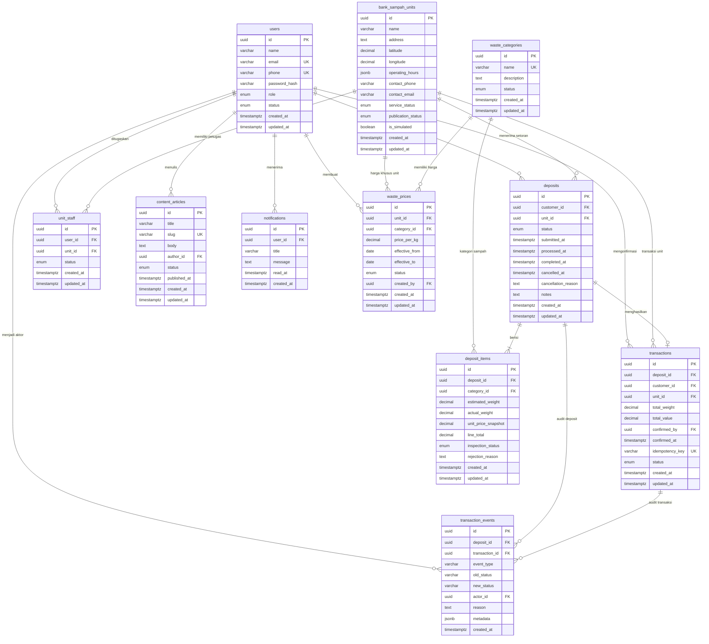

# ERD Awal dan Kamus Data

## Bank Sampah Digital

**Dokumen kerja untuk BSD-14 — ERD awal dan kamus data (MVP)**

> Acuan: `docs/PRD_Bank_Sampah_Digital_v1.1.md` bagian 10, `docs/USER_STORIES_P0.md`, dan `docs/BPMN_USE_CASE_RBAC.md`. Rancangan ini adalah **desain awal** untuk PostgreSQL + Prisma. Penamaan final mengikuti konvensi migrasi di `be-bsd/prisma/`.

## Informasi Dokumen

| Item | Keterangan |
| --- | --- |
| Task | BSD-14 · ERD awal dan kamus data |
| Versi | 1.0 |
| Tanggal | 12 November 2026 |
| Status | Selesai (v1.0) — siap diimplementasikan pada BSD-21 s.d. BSD-24 |
| Database | PostgreSQL 16+ |
| ORM | Prisma |
| Cakupan | Entitas MVP; entitas penjemputan disiapkan opsional untuk Fase 2 |

## 1. Prinsip Desain

1. **Penamaan:** tabel `snake_case` bentuk jamak; kolom `snake_case`; primary key `id`.
2. **Primary key:** `UUID` (`gen_random_uuid()`) agar aman untuk API publik dan mudah digabung.
3. **Waktu:** gunakan `TIMESTAMPTZ` untuk semua waktu; simpan dalam UTC.
4. **Uang & berat:** gunakan `DECIMAL`/`NUMERIC`, **bukan** float. Berat `DECIMAL(10,3)`, nilai uang `DECIMAL(14,2)`.
5. **Snapshot harga:** `deposit_items.unit_price_snapshot` menyimpan harga saat transaksi; perubahan harga master tidak mengubah transaksi lama.
6. **Audit:** `transaction_events` mencatat perubahan status, penolakan, pembatalan, dan koreksi (aktor, waktu, alasan).
7. **Soft delete:** data transaksi **tidak dihapus permanen**; gunakan status/event untuk pembatalan.
8. **Kepemilikan:** `customer_id`, `unit_id`, dan `actor_id` wajib divalidasi di server.
9. **Data simulasi:** tandai dengan `is_simulated` pada unit/harga/konten yang belum diverifikasi.
10. **Konsistensi status:** gunakan enum yang sama antara database, API, dan UI (bahasa Indonesia untuk nilai status yang dilihat pengguna).

## 2. ERD (MVP)

> Catatan: `waste_prices.unit_id` boleh `NULL` untuk **harga global**. Harga unit (jika ada) menimpa harga global untuk kategori yang sama (D-04).

## 3. Kamus Data

### 3.1 `users`

Menyimpan seluruh pengguna: nasabah, petugas, dan admin.

| Kolom | Tipe | Null | Default | Constraint / Keterangan |
| --- | --- | --- | --- | --- |
| `id` | UUID | Tidak | `gen_random_uuid()` | Primary key. |
| `name` | VARCHAR(120) | Tidak | — | Nama pengguna. |
| `email` | VARCHAR(255) | Ya | NULL | Unik bila diisi. |
| `phone` | VARCHAR(20) | Ya | NULL | Unik bila diisi. |
| `password_hash` | VARCHAR(255) | Tidak | — | Hash kata sandi (Argon2/bcrypt). |
| `role` | ENUM | Tidak | — | `nasabah`, `petugas`, `admin`. |
| `status` | ENUM | Tidak | `active` | `active`, `inactive`, `pending`. |
| `created_at` | TIMESTAMPTZ | Tidak | `now()` | Waktu dibuat. |
| `updated_at` | TIMESTAMPTZ | Tidak | `now()` | Waktu diperbarui. |

**Constraint:** `CHECK (email IS NOT NULL OR phone IS NOT NULL)`.

### 3.2 `bank_sampah_units`

Menyimpan data Bank Sampah Unit.

| Kolom | Tipe | Null | Default | Constraint / Keterangan |
| --- | --- | --- | --- | --- |
| `id` | UUID | Tidak | `gen_random_uuid()` | Primary key. |
| `name` | VARCHAR(150) | Tidak | — | Nama unit. |
| `address` | TEXT | Tidak | — | Alamat lengkap. |
| `latitude` | DECIMAL(9,6) | Ya | NULL | Koordinat opsional. |
| `longitude` | DECIMAL(9,6) | Ya | NULL | Koordinat opsional. |
| `operating_hours` | JSONB | Ya | NULL | Contoh: `{"mon":"08:00-15:00", ...}`. |
| `contact_phone` | VARCHAR(20) | Ya | NULL | Kontak unit. |
| `contact_email` | VARCHAR(255) | Ya | NULL | Kontak unit. |
| `service_status` | ENUM | Tidak | `open` | `open`, `closed`, `temporarily_closed`. |
| `publication_status` | ENUM | Tidak | `draft` | `draft`, `published`, `unpublished`. |
| `is_simulated` | BOOLEAN | Tidak | `false` | `true` bila data contoh/belum diverifikasi. |
| `created_at` | TIMESTAMPTZ | Tidak | `now()` | Waktu dibuat. |
| `updated_at` | TIMESTAMPTZ | Tidak | `now()` | Waktu diperbarui. |

**Index:** `(publication_status)`, `(service_status)`.

### 3.3 `unit_staff`

Menghubungkan petugas dengan unit yang ditangani.

| Kolom | Tipe | Null | Default | Constraint / Keterangan |
| --- | --- | --- | --- | --- |
| `id` | UUID | Tidak | `gen_random_uuid()` | Primary key. |
| `user_id` | UUID | Tidak | — | FK → `users.id`. |
| `unit_id` | UUID | Tidak | — | FK → `bank_sampah_units.id`. |
| `status` | ENUM | Tidak | `active` | `active`, `inactive`. |
| `created_at` | TIMESTAMPTZ | Tidak | `now()` | Waktu dibuat. |
| `updated_at` | TIMESTAMPTZ | Tidak | `now()` | Waktu diperbarui. |

**Constraint:** `UNIQUE (user_id, unit_id)`. **Index:** `(unit_id, status)`, `(user_id, status)`.

### 3.4 `waste_categories`

Menyimpan kategori/jenis sampah.

| Kolom | Tipe | Null | Default | Constraint / Keterangan |
| --- | --- | --- | --- | --- |
| `id` | UUID | Tidak | `gen_random_uuid()` | Primary key. |
| `name` | VARCHAR(100) | Tidak | — | Nama kategori; unik. |
| `description` | TEXT | Ya | NULL | Deskripsi. |
| `status` | ENUM | Tidak | `active` | `active`, `inactive`. |
| `created_at` | TIMESTAMPTZ | Tidak | `now()` | Waktu dibuat. |
| `updated_at` | TIMESTAMPTZ | Tidak | `now()` | Waktu diperbarui. |

**Constraint:** `UNIQUE (name)`.

### 3.5 `waste_prices`

Menyimpan histori harga per kategori, global atau per unit.

| Kolom | Tipe | Null | Default | Constraint / Keterangan |
| --- | --- | --- | --- | --- |
| `id` | UUID | Tidak | `gen_random_uuid()` | Primary key. |
| `unit_id` | UUID | Ya | NULL | FK → `bank_sampah_units.id`; `NULL` = harga global. |
| `category_id` | UUID | Tidak | — | FK → `waste_categories.id`. |
| `price_per_kg` | DECIMAL(12,2) | Tidak | — | `CHECK (price_per_kg >= 0)`. |
| `effective_from` | DATE | Tidak | — | Awal periode berlaku. |
| `effective_to` | DATE | Ya | NULL | Akhir periode; `NULL` = masih berlaku. |
| `status` | ENUM | Tidak | `active` | `active`, `inactive`. |
| `created_by` | UUID | Ya | NULL | FK → `users.id` (admin pembuat). |
| `created_at` | TIMESTAMPTZ | Tidak | `now()` | Waktu dibuat. |
| `updated_at` | TIMESTAMPTZ | Tidak | `now()` | Waktu diperbarui. |

**Constraint:**
- `CHECK (effective_to IS NULL OR effective_to >= effective_from)`.
- **Tidak boleh tumpang tindih** untuk `(unit_id, category_id)` pada rentang tanggal yang sama. Implementasi: exclusion constraint PostgreSQL (`btree_gist` + `daterange`) atau validasi transaksi di aplikasi. Untuk `unit_id = NULL` (global), gunakan constraint terpisah/partial index.
- **Aturan D-04:** bila ada harga unit aktif dan harga global aktif untuk kategori yang sama, harga unit yang dipakai.

**Index:** `(category_id, effective_from DESC)`, `(unit_id, category_id, effective_from DESC)`.

### 3.6 `deposits`

Menyimpan pengajuan setoran nasabah.

| Kolom | Tipe | Null | Default | Constraint / Keterangan |
| --- | --- | --- | --- | --- |
| `id` | UUID | Tidak | `gen_random_uuid()` | Primary key. |
| `customer_id` | UUID | Tidak | — | FK → `users.id`; dari sesi server. |
| `unit_id` | UUID | Tidak | — | FK → `bank_sampah_units.id`. |
| `status` | ENUM | Tidak | `menunggu` | `menunggu`, `diproses`, `selesai`, `dibatalkan`. |
| `submitted_at` | TIMESTAMPTZ | Tidak | `now()` | Waktu pengajuan. |
| `processed_at` | TIMESTAMPTZ | Ya | NULL | Waktu mulai diproses. |
| `completed_at` | TIMESTAMPTZ | Ya | NULL | Waktu selesai. |
| `cancelled_at` | TIMESTAMPTZ | Ya | NULL | Waktu dibatalkan. |
| `cancellation_reason` | TEXT | Ya | NULL | Wajib bila `status = dibatalkan`. |
| `notes` | TEXT | Ya | NULL | Catatan tambahan. |
| `created_at` | TIMESTAMPTZ | Tidak | `now()` | Waktu dibuat. |
| `updated_at` | TIMESTAMPTZ | Tidak | `now()` | Waktu diperbarui. |

**Constraint:** `CHECK (status <> 'dibatalkan' OR cancellation_reason IS NOT NULL)`.
**Index:** `(customer_id, submitted_at DESC)`, `(unit_id, status, submitted_at)`.

### 3.7 `deposit_items`

Menyimpan detail kategori, estimasi, hasil timbang, snapshot harga, dan nilai per baris.

| Kolom | Tipe | Null | Default | Constraint / Keterangan |
| --- | --- | --- | --- | --- |
| `id` | UUID | Tidak | `gen_random_uuid()` | Primary key. |
| `deposit_id` | UUID | Tidak | — | FK → `deposits.id` `ON DELETE CASCADE`. |
| `category_id` | UUID | Tidak | — | FK → `waste_categories.id`. |
| `estimated_weight` | DECIMAL(10,3) | Tidak | — | Estimasi nasabah; `CHECK > 0`. |
| `actual_weight` | DECIMAL(10,3) | Ya | NULL | Hasil timbang petugas; `CHECK >= 0`. |
| `unit_price_snapshot` | DECIMAL(12,2) | Ya | NULL | Harga saat konfirmasi (snapshot). |
| `line_total` | DECIMAL(14,2) | Ya | NULL | `actual_weight × unit_price_snapshot`. |
| `inspection_status` | ENUM | Tidak | `pending` | `pending`, `accepted`, `rejected`. |
| `rejection_reason` | TEXT | Ya | NULL | Wajib bila `inspection_status = rejected`. |
| `created_at` | TIMESTAMPTZ | Tidak | `now()` | Waktu dibuat. |
| `updated_at` | TIMESTAMPTZ | Tidak | `now()` | Waktu diperbarui. |

**Constraint:**
- `UNIQUE (deposit_id, category_id)`.
- `CHECK (inspection_status <> 'rejected' OR rejection_reason IS NOT NULL)`.

**Index:** `(deposit_id)`.

### 3.8 `transactions`

Menyimpan transaksi final setelah konfirmasi petugas.

| Kolom | Tipe | Null | Default | Constraint / Keterangan |
| --- | --- | --- | --- | --- |
| `id` | UUID | Tidak | `gen_random_uuid()` | Primary key. |
| `deposit_id` | UUID | Tidak | — | FK → `deposits.id`; unik (1 deposit → 1 transaksi). |
| `customer_id` | UUID | Tidak | — | FK → `users.id`. |
| `unit_id` | UUID | Tidak | — | FK → `bank_sampah_units.id`. |
| `total_weight` | DECIMAL(12,3) | Tidak | — | Total berat aktual. |
| `total_value` | DECIMAL(14,2) | Tidak | — | Total nilai final. |
| `confirmed_by` | UUID | Tidak | — | FK → `users.id` (petugas). |
| `confirmed_at` | TIMESTAMPTZ | Tidak | `now()` | Waktu konfirmasi. |
| `idempotency_key` | VARCHAR(100) | Ya | NULL | Unik; mencegah transaksi ganda. |
| `status` | ENUM | Tidak | `active` | `active`, `cancelled`, `corrected`. |
| `created_at` | TIMESTAMPTZ | Tidak | `now()` | Waktu dibuat. |
| `updated_at` | TIMESTAMPTZ | Tidak | `now()` | Waktu diperbarui. |

**Constraint:** `UNIQUE (deposit_id)`, `UNIQUE (idempotency_key)`.
**Index:** `(customer_id, confirmed_at DESC)`, `(unit_id, confirmed_at DESC)`.

### 3.9 `transaction_events`

Jejak audit perubahan status, penolakan, pembatalan, dan koreksi.

| Kolom | Tipe | Null | Default | Constraint / Keterangan |
| --- | --- | --- | --- | --- |
| `id` | UUID | Tidak | `gen_random_uuid()` | Primary key. |
| `deposit_id` | UUID | Ya | NULL | FK → `deposits.id`. |
| `transaction_id` | UUID | Ya | NULL | FK → `transactions.id`. |
| `event_type` | VARCHAR(40) | Tidak | — | `status_change`, `rejection`, `cancellation`, `correction`, `price_change`. |
| `old_status` | VARCHAR(30) | Ya | NULL | Status sebelum perubahan. |
| `new_status` | VARCHAR(30) | Ya | NULL | Status sesudah perubahan. |
| `actor_id` | UUID | Tidak | — | FK → `users.id`. |
| `reason` | TEXT | Ya | NULL | Wajib untuk penolakan/pembatalan/koreksi. |
| `metadata` | JSONB | Ya | NULL | Data tambahan (mis. nilai lama/baru). |
| `created_at` | TIMESTAMPTZ | Tidak | `now()` | Waktu kejadian. |

**Constraint:** `CHECK (deposit_id IS NOT NULL OR transaction_id IS NOT NULL)`.
**Index:** `(deposit_id, created_at DESC)`, `(transaction_id, created_at DESC)`, `(actor_id, created_at DESC)`.

### 3.10 `content_articles`

Konten edukasi/berita untuk website.

| Kolom | Tipe | Null | Default | Constraint / Keterangan |
| --- | --- | --- | --- | --- |
| `id` | UUID | Tidak | `gen_random_uuid()` | Primary key. |
| `title` | VARCHAR(200) | Tidak | — | Judul. |
| `slug` | VARCHAR(200) | Tidak | — | Unik; untuk URL. |
| `body` | TEXT | Tidak | — | Isi artikel. |
| `author_id` | UUID | Tidak | — | FK → `users.id`. |
| `status` | ENUM | Tidak | `draft` | `draft`, `published`, `archived`. |
| `published_at` | TIMESTAMPTZ | Ya | NULL | Waktu publikasi. |
| `created_at` | TIMESTAMPTZ | Tidak | `now()` | Waktu dibuat. |
| `updated_at` | TIMESTAMPTZ | Tidak | `now()` | Waktu diperbarui. |

**Constraint:** `UNIQUE (slug)`. **Index:** `(status, published_at DESC)`.

### 3.11 `notifications` (opsional)

Notifikasi dalam aplikasi; hanya jika masuk MVP.

| Kolom | Tipe | Null | Default | Constraint / Keterangan |
| --- | --- | --- | --- | --- |
| `id` | UUID | Tidak | `gen_random_uuid()` | Primary key. |
| `user_id` | UUID | Tidak | — | FK → `users.id`. |
| `title` | VARCHAR(150) | Tidak | — | Judul notifikasi. |
| `message` | TEXT | Tidak | — | Isi notifikasi. |
| `read_at` | TIMESTAMPTZ | Ya | NULL | Waktu dibaca; `NULL` = belum dibaca. |
| `created_at` | TIMESTAMPTZ | Tidak | `now()` | Waktu dibuat. |

**Index:** `(user_id, read_at)`.

## 4. Relasi dan Kardinalitas

| Relasi | Kardinalitas | Keterangan |
| --- | --- | --- |
| `users` → `deposits` | 1 : N | Satu nasabah membuat banyak pengajuan. |
| `users` → `unit_staff` | 1 : N | Satu petugas dapat ditugaskan ke beberapa unit. |
| `bank_sampah_units` → `unit_staff` | 1 : N | Satu unit memiliki banyak petugas. |
| `bank_sampah_units` → `deposits` | 1 : N | Satu unit menerima banyak pengajuan. |
| `bank_sampah_units` → `waste_prices` | 1 : N | Harga khusus unit (opsional). |
| `waste_categories` → `waste_prices` | 1 : N | Satu kategori punya histori harga. |
| `waste_categories` → `deposit_items` | 1 : N | Satu kategori muncul di banyak item. |
| `deposits` → `deposit_items` | 1 : N | Satu pengajuan berisi beberapa kategori. |
| `deposits` → `transactions` | 1 : 0..1 | Satu pengajuan menghasilkan maksimal satu transaksi. |
| `deposits` → `transaction_events` | 1 : N | Audit perubahan pada pengajuan. |
| `transactions` → `transaction_events` | 1 : N | Audit pembatalan/koreksi transaksi. |
| `users` → `content_articles` | 1 : N | Satu admin menulis banyak artikel. |

## 5. Snapshot Harga dan Histori Harga

Alur yang dijamin skema:

1. Admin membuat/mengubah `waste_prices` dengan `effective_from` (dan `effective_to` bila ada).
2. Saat petugas mengonfirmasi transaksi, server memilih harga aktif:
   - harga unit aktif untuk `(unit_id, category_id)` **jika ada**;
   - jika tidak, harga global aktif (`unit_id IS NULL`).
3. Server menyalin harga tersebut ke `deposit_items.unit_price_snapshot`.
4. Server menghitung `line_total = actual_weight × unit_price_snapshot` dan `transactions.total_value`.
5. Perubahan harga berikutnya **tidak** mengubah baris transaksi lama karena nilai sudah disalin.

**Contoh:**

| Waktu | Aksi | Dampak |
| --- | --- | --- |
| 1 Nov | Harga global PET = 3.000/kg | Harga aktif. |
| 5 Nov | Transaksi A selesai, 2 kg | Snapshot 3.000; nilai 6.000. |
| 10 Nov | Harga global PET naik 4.000/kg | Transaksi A tetap 6.000. |
| 12 Nov | Transaksi B selesai, 2 kg | Snapshot 4.000; nilai 8.000. |

## 6. Indeks dan Constraint Ringkas

| Tabel | Index / Constraint Utama |
| --- | --- |
| `users` | `UNIQUE(email)`, `UNIQUE(phone)`, `CHECK(email OR phone)` |
| `bank_sampah_units` | Index `(publication_status)`, `(service_status)` |
| `unit_staff` | `UNIQUE(user_id, unit_id)`, Index `(unit_id, status)` |
| `waste_categories` | `UNIQUE(name)` |
| `waste_prices` | `CHECK(price_per_kg >= 0)`, anti-overlap periode, Index `(unit_id, category_id, effective_from)` |
| `deposits` | `CHECK(dibatalkan → alasan)`, Index `(customer_id, submitted_at)`, `(unit_id, status)` |
| `deposit_items` | `UNIQUE(deposit_id, category_id)`, `CHECK(rejected → alasan)` |
| `transactions` | `UNIQUE(deposit_id)`, `UNIQUE(idempotency_key)` |
| `transaction_events` | `CHECK(deposit_id OR transaction_id)`, Index per entitas & waktu |
| `content_articles` | `UNIQUE(slug)`, Index `(status, published_at)` |
| `notifications` | Index `(user_id, read_at)` |

## 7. Pemetaan ke Prisma (Rencana)

| Tabel | Model Prisma (usulan) | Task skema |
| --- | --- | --- |
| `users`, `bank_sampah_units`, `unit_staff` | `User`, `BankSampahUnit`, `UnitStaff` | BSD-21 |
| `waste_categories`, `waste_prices` | `WasteCategory`, `WastePrice` | BSD-22 |
| `deposits`, `deposit_items`, `transactions` | `Deposit`, `DepositItem`, `Transaction` | BSD-23 |
| `transaction_events`, `content_articles`, `notifications` | `TransactionEvent`, `ContentArticle`, `Notification` | BSD-24 |

**Catatan Prisma:**
- Gunakan `@db.Decimal(10, 3)` untuk berat dan `@db.Decimal(14, 2)` untuk nilai.
- Enum Prisma mengikuti nilai status (gunakan nama yang konsisten).
- `@@unique` dan `@@index` mengikuti tabel bagian 6.
- Migrasi harus version-controlled dan tidak diubah setelah ter-commit.

## 8. Entitas Fase 2 (Opsional — Penjemputan)

> **Tidak termasuk MVP (D-01).** Rancangan ringkas ini hanya persiapan Fase 2 dan **tidak wajib** diimplementasikan pada Sprint 2.

| Entitas | Data utama | Catatan |
| --- | --- | --- |
| `pickup_requests` | id, customer_id, unit_id, address, scheduled_at, status, notes | Permintaan penjemputan. |
| `pickup_assignments` | id, pickup_request_id, staff_id, assigned_at, status | Penugasan petugas. |
| `pickup_events` | id, pickup_request_id, event_type, actor_id, reason, created_at | Audit status penjemputan. |

Status penjemputan (usulan Fase 2): `menunggu`, `ditugaskan`, `dijemput`, `diserahkan`, `dibatalkan`, `gagal`.

## 9. Catatan dan Pertanyaan Terbuka

1. **Format jam operasional:** `JSONB` memberi fleksibilitas, tetapi validasi bentuk perlu disepakati saat implementasi.
2. **Anti-overlap harga:** perlu keputusan teknis antara exclusion constraint PostgreSQL atau validasi transaksi aplikasi (terutama untuk `unit_id NULL`).
3. **Pembulatan nilai:** aturan pembulatan (`ROUND` 2 desimal) perlu dikunci di server dan diuji (TC-04/TC-14).
4. **Soft delete:** data master (unit/kategori) dinonaktifkan lewat `status`, bukan dihapus, agar riwayat transaksi tetap valid.
5. **Notifikasi:** tabel opsional; hanya dibuat jika FR-20 masuk MVP.
6. **Data simulasi:** `is_simulated` disarankan juga pada `waste_prices` bila harga contoh belum diverifikasi; dapat ditambahkan saat implementasi.
7. **Idempotency:** `transactions.idempotency_key` perlu diisi dari klien/server; strategi final ditetapkan pada task BE konfirmasi transaksi.
