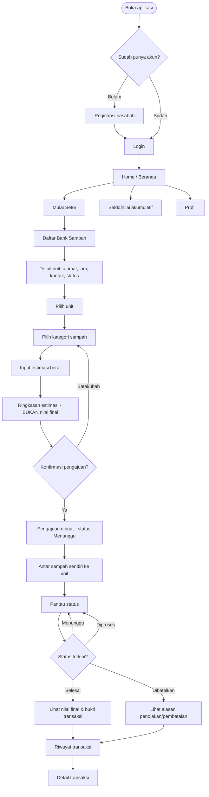
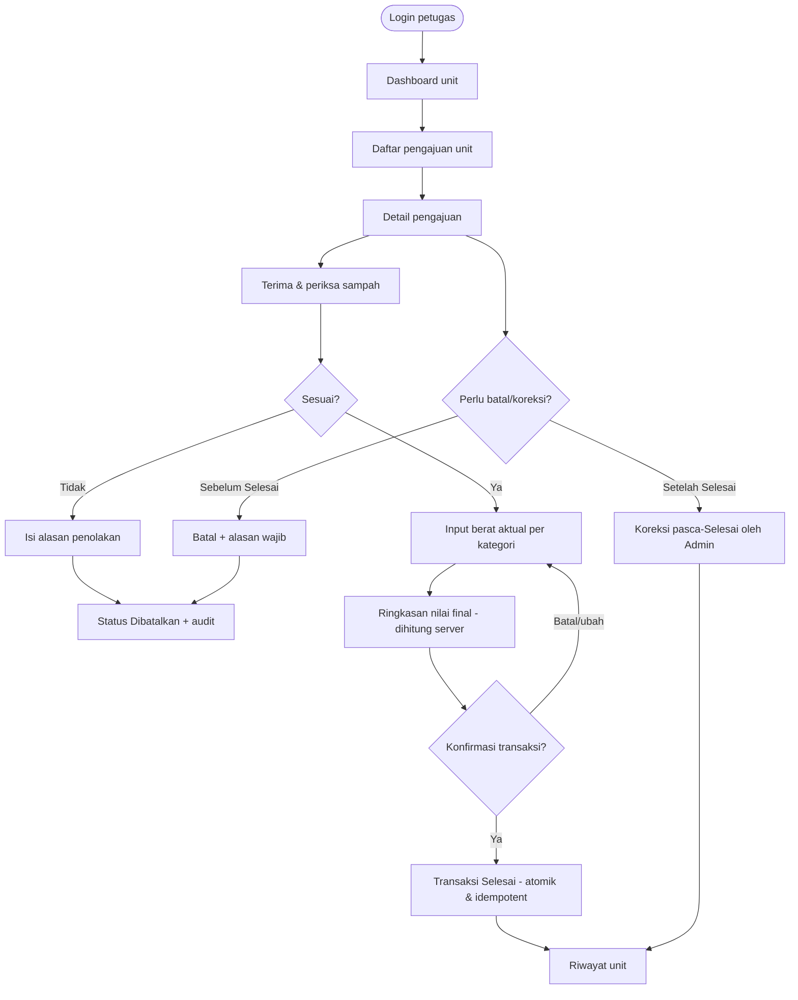
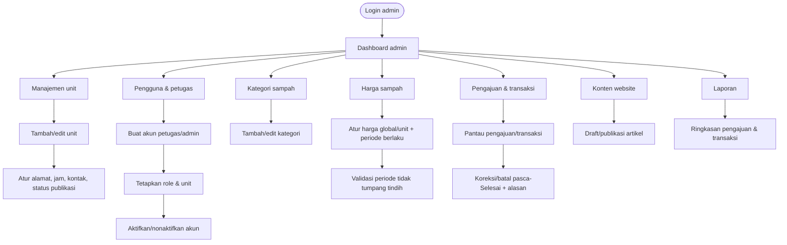
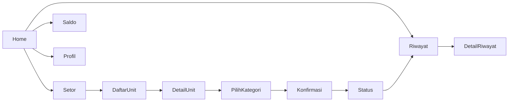
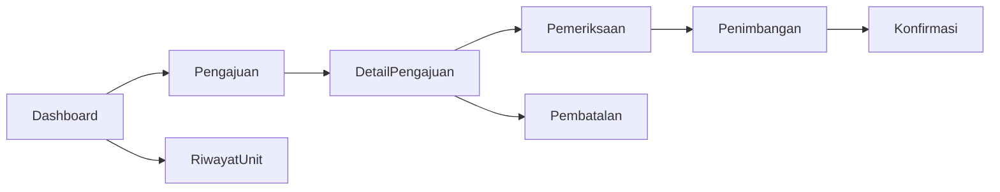
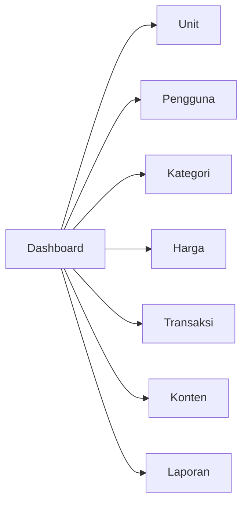

# User Flow Nasabah, Petugas, dan Admin

## Bank Sampah Digital

**Dokumen kerja untuk BSD-15 — User flow nasabah, petugas, dan admin (MVP)**

> Acuan: `docs/PRD_Bank_Sampah_Digital_v1.1.md` bagian 6 dan 13.1, `docs/USER_STORIES_P0.md`, `docs/BPMN_USE_CASE_RBAC.md`, dan `docs/ERD_KAMUS_DATA.md`. Ruang lingkup MVP adalah **nasabah antar mandiri** (D-01); alur penjemputan tidak termasuk.

## Informasi Dokumen

| Item | Keterangan |
| --- | --- |
| Task | BSD-15 · User flow nasabah, petugas, admin |
| Versi | 1.0 |
| Tanggal | 12 November 2026 |
| Status | **Disetujui Product Owner** (12 November 2026) |
| Platform | Satu PWA Next.js berbasis role (D-03) |
| Acuan | PRD v1.1, US-01 s.d. US-17, BPMN/RBAC BSD-13 |

## 1. Prinsip User Flow

1. **Satu aplikasi, tiga role:** nasabah, petugas, dan admin memakai PWA yang sama; menu dan akses dibedakan berdasarkan role.
2. **Alur utama singkat:** cari unit → ajukan setoran → pantau status → lihat riwayat.
3. **Estimasi ≠ final:** setiap nilai estimasi diberi label jelas "bukan nilai final".
4. **Status konsisten:** Menunggu, Diproses, Selesai, Dibatalkan.
5. **Aksi penting butuh konfirmasi:** ajukan setoran, konfirmasi transaksi, pembatalan, dan koreksi.
6. **Setiap layar punya state:** loading, empty, error, dan sukses.
7. **Data simulasi ditandai:** harga/lokasi/jam contoh wajib berlabel **SIMULASI**.

## 2. Peta Halaman per Role

| Role | Halaman |
| --- | --- |
| Nasabah | Login, Register, Lupa Password, Home, Daftar Bank Sampah, Detail Bank Sampah, Pilih Jenis Sampah, Konfirmasi Setoran, Status Setoran, Ringkasan Transaksi, Riwayat, Detail Riwayat, Saldo/Nilai Akumulatif, Profil |
| Petugas | Login, Dashboard, Daftar Pengajuan, Detail Pengajuan, Pemeriksaan & Penimbangan, Konfirmasi Transaksi, Pembatalan/Koreksi, Riwayat Unit |
| Admin | Login, Dashboard, Manajemen Unit, Pengguna/Petugas, Kategori Sampah, Harga Sampah, Pengajuan/Transaksi, Konten, Laporan |
| Publik | Beranda, Tentang, Cara Kerja, Informasi Bank Sampah, Edukasi/Artikel, Berita/Kegiatan, Kontak |

## 3. User Flow Nasabah

### 3.1 Diagram alur

### 3.2 Langkah dan state

| Langkah | Aksi pengguna | State yang harus ada |
| --- | --- | --- |
| Registrasi | Isi data, kirim | Loading, sukses, error validasi, email/telepon sudah dipakai |
| Login | Masukkan kredensial | Loading, sukses, error kredensial, akun nonaktif |
| Daftar unit | Lihat daftar unit terpublikasi | Loading, empty, error, label SIMULASI |
| Detail unit | Lihat alamat, jam, kontak, status | Loading, error, unit tidak tersedia |
| Pilih kategori | Pilih satu/lebih kategori | Loading, empty (harga belum tersedia) |
| Estimasi berat | Input angka > 0 | Validasi input, bantuan satuan kg |
| Ringkasan estimasi | Tinjau estimasi | Label "bukan nilai final", tombol ubah/batal |
| Konfirmasi | Kirim pengajuan | Konfirmasi aksi, loading, sukses, error |
| Status | Pantau status | Menunggu/Diproses/Selesai/Dibatalkan + alasan bila batal |
| Riwayat | Lihat daftar transaksi | Loading, empty, error |
| Detail transaksi | Lihat rincian | Nilai final, berat aktual, harga/kg, unit, tanggal |
| Saldo | Lihat nilai akumulatif | Penjelasan "catatan nilai setoran, bukan dana cair" |
| Profil | Lihat/ubah data | Validasi, sukses, error |

### 3.3 Catatan alur nasabah

- Nasabah **tidak** memilih jadwal penjemputan atau alamat penjemputan pada MVP.
- Setelah pengajuan dibuat, nasabah **mengantar sendiri** sampah ke unit.
- Nilai pada ringkasan adalah **estimasi**; nilai final muncul setelah petugas menimbang dan mengonfirmasi.
- Jika pengajuan Dibatalkan, alasan penolakan/pembatalan ditampilkan.
- Saldo selalu dijelaskan sebagai catatan nilai setoran, bukan uang yang dapat ditarik.

## 4. User Flow Petugas

### 4.1 Diagram alur

### 4.2 Langkah dan state

| Langkah | Aksi petugas | State yang harus ada |
| --- | --- | --- |
| Login | Masukkan kredensial | Loading, error, akun nonaktif |
| Dashboard | Lihat ringkasan pengajuan unit | Loading, empty, error |
| Daftar pengajuan | Filter status, pilih pengajuan | Loading, empty, error |
| Detail pengajuan | Lihat data nasabah & estimasi | Data unit sendiri; 403 bila beda unit |
| Pemeriksaan | Catat hasil per kategori | Pilihan diterima/ditolak |
| Penolakan | Isi alasan wajib | Validasi alasan, konfirmasi aksi |
| Penimbangan | Input berat aktual per kategori | Validasi angka, satuan kg |
| Ringkasan final | Tinjau nilai final | Nilai dihitung server, snapshot harga |
| Konfirmasi | Konfirmasi transaksi | Konfirmasi aksi, loading, sukses, idempotent |
| Pembatalan | Batalkan sebelum Selesai + alasan | Validasi alasan, audit |
| Koreksi pasca-Selesai | Diteruskan ke Admin | Pesan bahwa hanya Admin dapat mengoreksi |
| Riwayat unit | Lihat transaksi unit | Loading, empty, error |

### 4.3 Catatan alur petugas

- Petugas hanya melihat pengajuan **unit yang ditugaskan** (`unit_staff`).
- Petugas **tidak** menjemput sampah pada MVP; sampah diterima di unit.
- Berat aktual hanya diinput petugas; berat nasabah adalah estimasi.
- Konfirmasi transaksi harus **atomik & idempotent**; tombol tidak boleh membuat transaksi ganda saat retry.
- Pembatalan/koreksi **setelah Selesai** hanya dapat dilakukan Admin (kebijakan disetujui 12 Nov 2026).

## 5. User Flow Admin

### 5.1 Diagram alur

### 5.2 Langkah dan state

| Langkah | Aksi admin | State yang harus ada |
| --- | --- | --- |
| Login | Masukkan kredensial | Loading, error, akun nonaktif |
| Dashboard | Lihat ringkasan operasional | Loading, empty, error |
| Manajemen unit | Tambah/edit unit, atur publikasi | Validasi, sukses, error |
| Pengguna & petugas | Buat akun, tetapkan role/unit, aktif/nonaktif | Validasi, konfirmasi, error |
| Kategori sampah | Tambah/edit kategori | Validasi, sukses, error |
| Harga sampah | Atur harga global/unit + periode | Validasi periode, peringatan tumpang tindih |
| Pengajuan & transaksi | Pantau, koreksi/batal pasca-Selesai | Alasan wajib, konfirmasi, audit |
| Konten | Draft/publikasi artikel | Validasi, preview, sukses |
| Laporan | Lihat ringkasan | Loading, empty, filter |

### 5.3 Catatan alur admin

- Admin **tidak** membuat akun petugas/admin melalui registrasi publik; akun dibuat di menu pengguna.
- Perubahan harga tidak boleh mengubah transaksi lama (snapshot).
- Periode harga untuk kategori/unit yang sama tidak boleh tumpang tindih.
- Koreksi/pembatalan pasca-Selesai wajib alasan dan tercatat di `transaction_events`.
- Unit/kategori yang dinonaktifkan tidak boleh dihapus permanen agar riwayat tetap valid.

## 6. Navigasi Antar Halaman

### 6.1 Nasabah

### 6.2 Petugas

### 6.3 Admin

## 7. Alur yang Tidak Termasuk Sprint 1 (Fase 2)

- **Penjemputan sampah:** permintaan jemput, penjadwalan, penugasan petugas, serah-terima, gagal jemput. Tidak digambar sebagai alur MVP (D-01).
- **Pembayaran/penarikan saldo:** tidak termasuk MVP; saldo hanya catatan nilai setoran.
- **Scan identifikasi sampah:** opsional/P2, bukan alur utama.
- **Push notification:** pengembangan lanjutan; MVP hanya informasi status di aplikasi.

## 8. Traceability ke User Story

| Flow | User story terkait |
| --- | --- |
| Registrasi & login nasabah | US-01 |
| Login petugas/admin | US-02 |
| Daftar/detail unit | US-03 |
| Informasi kategori & harga | US-04 |
| Ajukan setoran | US-05 |
| Ringkasan estimasi | US-06 |
| Daftar pengajuan petugas | US-07 |
| Pembaruan status | US-08 |
| Penimbangan aktual | US-09 |
| Perhitungan transaksi | US-10 |
| Konfirmasi transaksi | US-11 |
| Riwayat transaksi | US-12 |
| Saldo/nilai akumulatif | US-13 |
| Pengelolaan data master | US-14 |
| Pemeriksaan & penolakan | US-15 |
| Pembatalan & koreksi | US-16 |
| Kontrol akses | US-17 |

## 9. Catatan dan Pertanyaan Terbuka

1. **Desain visual final** (warna, tipografi, komponen) ditetapkan pada BSD-16/BSD-17; dokumen ini hanya menetapkan alur.
2. **Pembatalan oleh nasabah** sebelum diproses belum termasuk alur MVP; jika dibutuhkan, tambahkan melalui Product Owner.
3. **Format jam operasional** dan tampilan status buka/tutup mengikuti data unit; detail komponen ditetapkan di design system.
4. **Halaman publik** (website) dikembangkan terpisah sesuai prioritas backlog; alur di dokumen ini fokus pada PWA.
5. **Label SIMULASI** wajib tampil pada data contoh sampai diverifikasi bersama BSU.
